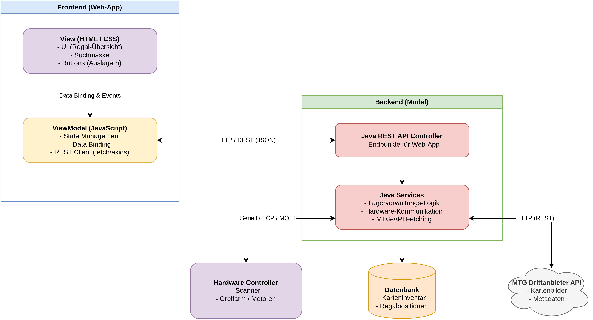

# YourMTGCards

YourMTGCards verwaltet physische Magic: The Gathering-Karten. Der MVP nimmt Scans von einer Raspberry-Pi-Software entgegen, speichert Bilder und Lagerorte, gleicht Karten manuell mit Scryfall ab und stellt Auslagerungsaufträge für die Hardware bereit.

## Architecture

Das Frontend unter `src/main/resources/static/` zeigt unbestätigte Scans und den Bestand, bietet die Scryfall-Suche und erstellt Auslagerungsaufträge. Das Java-Backend stellt JSON- und Multipart-REST-Endpunkte bereit. Abstrakte Druckdaten liegen getrennt von physischen Exemplaren in PostgreSQL.

Backend Java packages are grouped under `space.dragonfruit.YourMTGCards.backend`:

```text
backend/
├── config/       # Backend configuration
├── controller/   # REST endpoints
├── dto/          # API request and response objects
├── exception/    # Exceptions and API error handling
├── model/        # Domain models and persistence entities
├── repository/   # Data access
└── service/      # Application and business logic
```

`dto/` enthält API-Datentransferobjekte; `exception/` vereinheitlicht Fehlerantworten. Die Pi-Software kann unabhängig entwickelt werden und spricht das weiter unten beschriebene HTTP-Protokoll.



## Tech stack

- Java 25
- Spring Boot 4.1.1
- Maven
- PostgreSQL 17 (lokal über Docker Compose)
- Scryfall API für Kartensuche und Bestätigung

## Prerequisites

- A JDK 25 installation
- The included Maven Wrapper (`mvnw` / `mvnw.cmd`)
- Docker Compose zum Starten der lokalen PostgreSQL-Datenbank

## Build, test, and run

Aus dem Repository-Verzeichnis:

```bash
# PostgreSQL im Hintergrund starten
docker compose up -d database

# Anwendung starten (Datenbank muss erreichbar sein)
./mvnw spring-boot:run

# Tests nutzen eine eingebettete H2-Datenbank und benötigen kein PostgreSQL
./mvnw test
```

Die Weboberfläche ist anschließend unter `http://localhost:8080/` erreichbar. PostgreSQL-Verbindung und Bildverzeichnis können mit `DATABASE_URL`, `DATABASE_USERNAME`, `DATABASE_PASSWORD` und `CARD_IMAGE_DIRECTORY` überschrieben werden. Der Standardpfad für Scanbilder ist `./data/scans`.

Unter Windows kann statt `./mvnw` der Wrapper `mvnw.cmd` verwendet werden.

## Raspberry-Pi HTTP-Protokoll

Die Hardware spricht dieselbe Origin wie das Backend. Es gibt im MVP noch keine Authentifizierung; die Anwendung sollte daher nur in einem vertrauenswürdigen lokalen Netzwerk betrieben und nicht direkt ins Internet gestellt werden.

### Scan hochladen

`POST /api/hardware/scans` erwartet `multipart/form-data` mit einem JSON-Teil `scan` und dem JPEG- oder PNG-Teil `image`. Die Maschine vergibt die UUID und übermittelt die bekannte Position. `recognizedName` ist optional und kann den von einer später ergänzten Pi-OCR vorerkannten Namen enthalten.

```bash
curl -X POST http://localhost:8080/api/hardware/scans \
  -F 'scan={"uuid":"12f7d4ef-5f74-4fb4-bdea-47218530e5db","rackNumber":"R1","boxNumber":"B07","recognizedName":"Black Lotus"};type=application/json' \
  -F 'image=@card.jpg;type=image/jpeg'
```

Erfolgreiche Uploads bekommen den Status `PENDING`. Das Bild wird lokal außerhalb des Webroots abgelegt; die API liefert es über `/api/scans/{uuid}/image` aus. OCR oder Set-Icon-Erkennung ist nicht enthalten: bis die Pi-Software diese liefert, erfolgt der Abgleich über die manuelle Scryfall-Suche im Browser.

### Scans, Suche und Bestätigung

- `GET /api/scans?status=PENDING` listet unbestätigte Scans auf.
- `GET /api/cards/search?q=Black%20Lotus` sucht konkrete Scryfall-Drucke.
- `POST /api/scans/{uuid}/confirm` mit JSON `{"scryfallId":"<Scryfall-UUID>"}` bestätigt die Ausgabe. Metadaten werden dabei anhand der Scryfall-ID wiederverwendet.
- `GET /api/scans?q=Lotus` durchsucht den gesamten Bestand.

### Auslagerung

- `POST /api/inventory/{uuid}/retrieval` erstellt für ein bestätigtes Exemplar einen dauerhaften Auftrag.
- `GET /api/hardware/retrieval-commands` liefert nicht quittierte Aufträge chronologisch; die Pi-Software kann die Abfrage wiederholen.
- Nach erfolgreicher physischer Entnahme quittiert der Pi mit `POST /api/hardware/retrieval-commands/{commandId}/complete`. Die Quittierung ist idempotent.

Der Datenbank-Schemaabgleich verwendet im MVP `spring.jpa.hibernate.ddl-auto=update`. Vor produktivem Betrieb sollten Schemaänderungen über Migrationen wie Flyway verwaltet und die Standarddatenbank-Zugangsdaten ersetzt werden.

Eine nach Dateien und Abläufen gegliederte Beschreibung des Projekts steht in der [Projektübersicht](./PROJECT_OVERVIEW.md).

```bat
mvnw.cmd spring-boot:run
```

Die Anwendung ist auf einen lauffähigen lokalen MVP ausgelegt. Für den Produktivbetrieb fehlen insbesondere Hardware-OCR, Authentifizierung für Pi-Endpunkte und Datenbankmigrationen.
